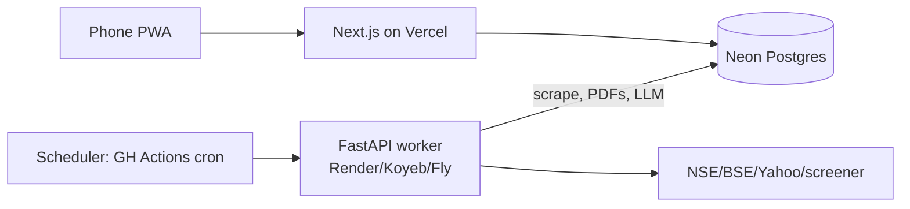
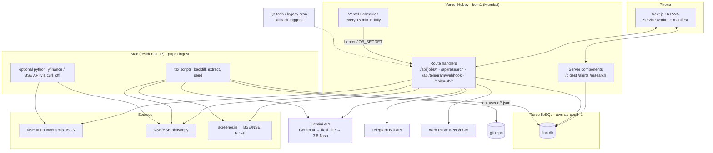

# 08 — Systems & engineering architecture for FINN

Author: systems/engineering researcher. Date: Sunday 8 Nov 2026 (day 0 of 7). Scope: pick the stack, data layer, scheduling, notifications, PDF pipeline, demo-reliability engineering and repo tooling for a mobile-first prototype that **must not fail in a grader's hands**.

Everything marked **[verified]** was checked today against vendor docs (URL given) or run on this machine (command + result given). **[reported]** = third-party source, not vendor-confirmed. **[unverified]** = assumption to test on day 1.

---

## 0. TL;DR

**Recommended: "Next.js monolith + offline ingestion CLI" (Architecture B+).**

- One TypeScript repo: **Next.js 16.4 (App Router, Turbopack) PWA on Vercel Hobby, functions pinned to `bom1` (Mumbai)**, **Turso/libSQL (Mumbai) via Drizzle** for live data, **a committed SQLite seed** so `pnpm dev` works offline with zero secrets.
- Ingestion is a set of **idempotent `POST /api/jobs/*` endpoints**, triggered by **Vercel Schedules (public beta since 5 Nov 2026: every 15 min on Hobby)** with **Upstash QStash** and **legacy Vercel Cron** as drop-in fallbacks. The scheduler is swappable; the job code is not.
- Sources chosen for reachability from a datacenter, measured today: **NSE `corporate-announcements` JSON (200 from plain `fetch` and from a datacenter)**, **NSE/BSE bhavcopy EOD files (200, one file/day for every listed stock)**, **screener.in (200) → BSE/NSE PDF archives (200)**. Yahoo (429 to plain clients) and the BSE JSON API (TLS-fingerprinted by Akamai) are **fallbacks run from the Mac** via a tiny Python `curl_cffi`/`yfinance` script — the "residential IP escape hatch".
- LLM: **all heavy extraction precomputed offline and cached in the DB**; runtime calls only for ad-hoc tickers, routed **Gemma 4 (free, 14.4k RPD) → gemini-3.5-flash-lite (500 RPD) → gemini-3.8-flash (20 RPD)** with a DB-backed budget ledger. The free tier is far tighter than folklore says (3.8-flash = **20 requests/day**).
- Notifications: **in-app inbox (always works) + Telegram bot (free, instant, graders subscribe via `t.me/<bot>?start=<token>` in 5 s) + Web Push (Android now; iOS only when installed to Home Screen)**. Email only if a domain is available (Resend needs a verified domain to mail anyone but yourself).
- PDFs: **pymupdf text (4.4 ms/page measured) → section selection → flash-lite structured extraction; statement tables sent as a few PDF pages natively to Gemini (258 tokens/page)**. Never parse a 300-page annual report inside a request.

Top risks: Gemini free quota exhaustion mid-demo (mitigated by precompute + ledger), NSE/BSE posture change (mitigated by seed snapshot + Mac fallback), Vercel Schedules being 3 days old (mitigated by QStash/legacy cron), empty "last 24h" digest on a quiet day (mitigated by window auto-widening + seeded history).

---

## 1. What I actually verified today (evidence)

### 1.1 Environment

| Check | Result |
|---|---|
| `vercel whoami` | **Not logged in** — "The specified token is not valid. Use `vercel login`". CLI 48.6.7. Day-1 task. |
| `docker info` | Client 27.4.0 present, **daemon not running** (Docker Desktop stopped). Nothing in the recommended stack needs Docker. |
| CLIs absent | `wrangler`, `flyctl`, `railway`, `netlify`, `supabase`, `eas`, `expo`, `turso`, `neonctl`, `gh` |
| Runtimes | Node 24.9.0, pnpm 10.17.1, bun 1.2.4, Python 3.14.4, `uv` 0.6.3 (used `uv venv --python 3.12`) |
| Gemini key | `models.list` returns 61 models incl. `gemini-3.8-flash`, `gemini-3.5-flash-lite`, `gemini-3.1-flash-lite`, `gemini-4-argon`, `gemma-4-26b-a4b-it`, `gemma-4-31b-it`. **`gemini-2.5-flash-lite` → HTTP 404 "no longer available to new users; use gemini-3.5-flash-lite"**. Do not plan around 2.5 models. |

### 1.2 Source reachability (this is the crux of "where does ingestion run")

Probed from this Mac (residential IP) with plain `curl` (Chrome UA), Node 24 `fetch` (undici), and Python `curl_cffi` (`impersonate="chrome"`); and from a **datacenter** via the isolated web-fetch server available to me.

| Source | plain curl | Node `fetch` | curl_cffi | datacenter | Notes |
|---|---|---|---|---|---|
| `www.nseindia.com/` (homepage) | **403** | — | 200 | — | Akamai Bot Manager; TLS/JA3 fingerprinting, not geo ([nsepython transport notes](https://github.com/aeron7/nsepython/blob/master/nsepython/rahu.py)) |
| `www.nseindia.com/api/corporate-announcements?index=equities` | **200**, 29 KB JSON, 20 rows, 0.28 s | **200**, 358 ms | 200 | **200**, 28.5 KB | Looser Akamai policy on this endpoint — same finding as [nse-mcp spike (Aug 2026)](https://github.com/pritam-patil/nse-mcp/blob/main/DATA_SOURCES.md), 22/22 from Cloudflare Workers. Fields: `symbol, desc, attchmntFile (PDF url), attchmntText, an_dt, sort_date, sm_isin, hasXbrl, fileSize …` |
| `www.nseindia.com/api/quote-equity` | — | — | **403** | 403 (nse-mcp) | Stricter policy; don't depend on it |
| `api.bseindia.com/BseIndiaAPI/api/AnnSubCategoryGetData/w` | **403** Akamai | **TLS failure** ("fetch failed") | **200** | **504** | BSE *JSON API* is the hard one (contradicts the brief's assumption). Needs Chrome TLS impersonation ⇒ Python/`curl_cffi`, residential or at least non-undici client |
| BSE bhavcopy `bseindia.com/download/BhavCopy/Equity/BhavCopy_BSE_CM_0_0_0_20261106_F_0000.CSV` | **200**, 864 KB, 0.25 s | **200**, 86 ms | — | n/t | EOD OHLCV for **every** BSE stock in one file |
| NSE bhavcopy `nsearchives.nseindia.com/content/cm/BhavCopy_NSE_CM_0_0_0_20261106_F_0000.csv.zip` | **200**, 197 KB zip | **200** | — | n/t | EOD for every NSE stock in one file |
| Yahoo `query1.finance.yahoo.com/v8/finance/chart/RELIANCE.NS` | **429** | **429** | — | — | `yfinance 1.8.0` (uses curl_cffi) **works: 6 rows in 504 ms**. Cloud IPs commonly 429 ([yfinance #2518](https://github.com/ranaroussi/yfinance/issues/2518)) |
| `www.screener.in/company/RELIANCE/consolidated/` | **200**, 271 KB | **200**, 174 ms | — | **200** | Documents section links ARs (`bseindia.com/bseplus/AnnualReport/…pdf`) and transcripts (`bseindia.com/stockinfo/AnnPdfOpen.aspx?Pname=…pdf`) |
| BSE AR PDF (25.4 MB) / BSE `AnnPdfOpen` PDF (6.2 MB) / NSE archive PDF (6.4 MB) | **200** 1.3 s / 0.45 s / 0.4 s | **200** / **200** | — | n/t | PDF archives are *not* behind the strict policy |

**Implications.** A Vercel function can poll NSE announcements and fetch bhavcopies/PDFs with plain `fetch` today. Nothing user-facing should depend on Yahoo or the BSE JSON API; both become Mac-run fallbacks. `[unverified]` whether Vercel's `bom1` egress specifically is allowed by NSE — test with one deployed route on day 1 (5 minutes), keep the seed snapshot as the safety net.

### 1.3 PDF benchmarks (real filings pulled above)

| Tool | Document | Result |
|---|---|---|
| `pymupdf` (Python) | Reliance AR FY25, **297 pages, 25 MB** | 1,691,858 chars (~**423k tokens**) in **1.30 s** (4.4 ms/page) |
| `pymupdf` | 77-page BSE filing | 44k chars (~11k tokens) in 0.08 s |
| `pdftotext -layout` (poppler, installed) | same AR | 1.49 s (layout mode inflates to 4.4M chars) |
| `unpdf` (Node, pdfjs) | 77 pages / 297 pages | **217 ms, RSS 148 MB / 1.5 s, RSS 482 MB** — fits a 2 GB Vercel function |
| `pdfplumber.extract_tables` | 3-page results newspaper ad | **0 tables, 3.8 s** — heuristics fail on Indian results layouts |

A single annual report is ~423k tokens of text: **above the 250k input-TPM free-tier cap and 40 % of a 1M context**. Section selection/chunking is mandatory, not optional. Sent as native PDF instead, the same 297 pages cost only **297 × 258 ≈ 77k tokens** ([Gemini document understanding](https://ai.google.dev/gemini-api/docs/document-processing): "each document page is equivalent to 258 tokens", limit 50 MB / 1000 pages).

### 1.4 Gemini smoke test (2 requests spent)

| Model | Latency | Behaviour |
|---|---|---|
| `gemini-3.5-flash-lite` | **0.98 s** | 94 in / 3 out tokens; classified a filing title correctly-ish (`press_release`; taxonomy says newspaper ad of results → `results`, so classification prompts must embed the reference table's hints) |
| `gemma-4-26b-a4b-it` | 2.78 s | **Thinks by default** (61 thought tokens hit `maxOutputTokens: 64`). Set `generationConfig.thinkingConfig.thinkingLevel: "minimal"` ([Gemma on Gemini API](https://ai.google.dev/gemma/docs/core/gemma_on_gemini_api)) |

---

## 2. Verified platform limits (the numbers the design rests on)

### 2.1 Hosting / compute

| Item | Value | Source |
|---|---|---|
| Vercel Hobby function duration | **300 s default and max** (Fluid compute). Pro 800 s | [Duration docs](https://vercel.com/docs/functions/configuring-functions/duration), [Limits](https://vercel.com/docs/functions/limitations) **[verified]** |
| Vercel Hobby function memory | **2 GB** max; Standard CPU | [Limits](https://vercel.com/docs/functions/limitations) |
| Vercel Hobby monthly compute | **4 h Active CPU, 360 GB-h provisioned memory, 1 M invocations, 100 GB fast data transfer**; 100 deployments/day; runtime logs retained **1 hour** | [Pricing](https://vercel.com/pricing), [Hobby plan](https://vercel.com/docs/plans/hobby) |
| Vercel function region | Hobby = **single region, selectable**; `bom1` = Mumbai (ap-south-1). `vercel.json`: `{"regions":["bom1"]}`. `preferredRegion` in Next.js is deprecated | [Regions](https://vercel.com/docs/functions/configuring-functions/region), [Region list](https://vercel.com/docs/regions) |
| Vercel Hobby terms | Personal, non-commercial use; usage caps are hard (cannot buy more) | [Hobby plan](https://vercel.com/docs/plans/hobby) |
| Next.js | **16.4.5 = Active LTS (3 Nov 2026 security release)**, 15.5.29 maintenance; Turbopack default for dev+build | [Release](https://github.com/vercel/next.js/releases/tag/v16.4.5), [Turbopack](https://nextjs.org/docs/app/api-reference/turbopack) |
| Cloudflare Workers Free | 100k req/day, **10 ms CPU/invocation**, 128 MB, 50 subrequests, **5 Cron Triggers/account**; D1 free: 5 GB total / 500 MB per DB / 5 M rows read/day / 100k rows written/day; R2 free: 10 GB, 1 M class-A, 10 M class-B, free egress | [Workers limits](https://developers.cloudflare.com/workers/platform/limits/), [Pricing](https://developers.cloudflare.com/workers/platform/pricing/), [D1 limits](https://developers.cloudflare.com/d1/platform/limits/) |
| Render Free (Python worker host) | **Spins down after 15 min idle, ~1 min to wake**, 750 h/mo, 5 GB bandwidth | [Render free docs](https://render.com/docs/free) |
| Fly.io / Koyeb / Railway | Fly: **no free tier** (trial only); Koyeb: card + $29 hold, free instance sleeps after 1 h; Railway: $1/mo credit after $5 trial | [State of free hosting 2026](https://snapdeploy.dev/state-of-free-hosting) **[reported]** |
| Expo | Free: **15 iOS + 15 Android builds/mo, low-priority queue (90+ min waits possible)**; TestFlight needs **$99 Apple Developer** account; external testers need **Beta App Review** on first build; Expo Go is "not for distribution" | [Expo pricing](https://expo.dev/pricing/), [Review overview](https://docs.expo.dev/review/overview/), [expo-go-usage](https://github.com/expo/fyi/blob/main/expo-go-usage.md) |

### 2.2 Data layer

| Item | Value | Source |
|---|---|---|
| **Turso Free** | 100 DBs, **5 GB**, **500 M rows read/mo, 10 M rows written/mo**, 3 GB syncs, **no cold starts** (since Mar 2025), **hard block on any exceeded metric**, Mumbai location `aws-ap-south-1` | [Pricing](https://turso.tech/pricing), [Developer plan post](https://turso.tech/blog/turso-cloud-debuts-the-new-developer-plan), [Regions](https://turso.tech/blog/turso-cloud-new-regions) |
| Turso full-text search | **Conflicting docs**: libSQL docs list FTS5 as preloaded; the new Rust engine's COMPAT says **FTS5 not supported**, use Tantivy `CREATE INDEX … USING fts` + `fts_match()` | [SQLite extensions](https://docs.turso.tech/features/sqlite-extensions) vs [COMPAT.md](https://github.com/tursodatabase/turso/blob/main/COMPAT.md), [Turso FTS](https://docs.turso.tech/sql-reference/functions/fts) — **do not depend on FTS** |
| **Neon Free** | 100 projects, **100 CU-h/project/mo**, 1 GB storage/project, autoscale ≤2 CU, **scale-to-zero after 5 min (cannot disable)**, cold start "a few hundred ms", **does not pause for inactivity** | [Free plan FAQ](https://neon.com/faqs/free-plan-limits-and-quotas), [Scale to zero](https://neon.com/docs/introduction/scale-to-zero) |
| **Supabase Free** | 500 MB DB, 2 active projects, **paused after 7 days of low activity** (restorable from dashboard within 1 year) | [Project pausing](https://supabase.com/docs/guides/platform/free-project-pausing), [Pricing](https://supabase.com/pricing) |
| Vercel Blob (Hobby) | **1 GB storage, 10k simple ops, 2k advanced ops (uploads/list), 10 GB transfer per month; hard block when exceeded** | [Blob pricing](https://vercel.com/docs/vercel-blob/usage-and-pricing) |
| Vercel KV | Discontinued as a first-party product; Redis via Marketplace (Upstash). Not needed here | — |

### 2.3 Scheduling / background work

| Item | Value | Source |
|---|---|---|
| **Vercel Schedules (public beta, 5 Nov 2026)** | All plans. Hobby: **min interval 15 min, fixed 15-min jitter, 5,000 runs/mo, 500 dynamic creations/mo, 100 static schedules per deployment, 1,000 schedules/team**; IANA timezone support; targets: `path` (GET/POST, `CRON_SECRET`), private `function` (`schedule/v1beta` trigger), or Queue `topic` (**only target with retries**) | [Changelog](https://vercel.com/changelog/vercel-schedules-is-now-in-public-beta), [Limits](https://vercel.com/docs/schedules/limits), [Handle runs](https://vercel.com/docs/schedules/handle-runs) |
| Vercel Cron Jobs (legacy, GA) | 100/project all plans (since 20 Jan 2026). Hobby: **once per day max, fires anywhere in the hour (±59 min)**, UTC only, **no retries**; `vercel.json` `crons`; Vercel sends `Authorization: Bearer $CRON_SECRET` | [Usage & pricing](https://vercel.com/docs/schedules/cron-jobs/usage-and-pricing), [Manage](https://vercel.com/docs/schedules/cron-jobs/manage-cron-jobs) |
| Vercel Queues (beta) | Hobby **1 M API operations/mo**; at-least-once, retries, 7-day TTL, 100 MB msgs | [Queues pricing](https://vercel.com/docs/queues/pricing) |
| **Upstash QStash Free** | **1,000 messages/day**, **10 active schedules**, retries free, HTTP response wait up to 15 min, 1 MB payload | [QStash pricing](https://upstash.com/pricing/qstash) |
| GitHub Actions | **Free & unlimited on public repos** (standard runners). `schedule`: min 5 min, **delayed under load, runs may be dropped**, disabled after 60 days inactivity; measured: ~half of daily crons run ~20 min late, the rest **3–7 h late**; `workflow_dispatch` is the fix | [Events](https://docs.github.com/en/actions/reference/workflows-and-actions/events-that-trigger-workflows), [Billing](https://docs.github.com/en/billing/concepts/product-billing/github-actions), [Lateness measurement](https://blog.peng.ly/github-cron-two-lanes/) **[reported]** |
| Inngest Free | 50k executions/mo (run + each step), 5 concurrent steps | [Pricing](https://www.inngest.com/pricing) |
| Trigger.dev Free | $5 compute credit/mo, 20 concurrent runs, 10 schedules | [Pricing](https://trigger.dev/pricing), [Limits](https://trigger.dev/docs/limits) |

### 2.4 LLM (Gemini Developer API, free tier)

Google no longer publishes a per-model free table ("view your active rate limits in AI Studio"; limits are **per project**, RPD resets **midnight Pacific = 13:30 IST**). Third-party readouts of AI Studio in Oct–Nov 2026 agree:

| Model | RPM | Input TPM | RPD | Price (paid, per 1M in/out) | Notes |
|---|---|---|---|---|---|
| `gemini-3.8-flash` | **5** | 250k | **20** | $0.75 / $3.75 (to 31 Dec 2026) | Free tier "free of charge"; context caching free on free tier |
| `gemini-3.6-flash` | 5 | 250k | 20 | same | legacy; 3.7 and 3.5-flash were deprecated 8 Oct 2026 |
| `gemini-3.5-flash-lite` | **10–15** | 250k | **500** | $0.30 / $2.50 | **workhorse** |
| `gemini-3.1-flash-lite` | 10–15 | 250k | 500 | $0.15 / $1.25 | cheaper paid fallback |
| `gemma-4-26b-a4b-it`, `gemma-4-31b-it` | **30** | **16k** | **14,400** | free only | 262k context; **thinks by default**; TPM cap ⇒ short prompts only (classification, one-liners) |
| `gemini-4-argon`, `gemini-3.1-pro-preview` | 0 | — | 0 | $2/$10 … | **not on free tier** |
| PDFs | 50 MB / 1000 pages, **258 tokens/page**; Files API free, 20 GB/project, **48 h retention** | | | |

Sources: [Rate limits](https://ai.google.dev/gemini-api/docs/rate-limits) **[verified: tiers, per-project, PT reset]**; [Pricing](https://ai.google.dev/gemini-api/docs/pricing) **[verified: free-tier columns, document token rule]**; [scriptbyai readout 5 Nov 2026](https://www.scriptbyai.com/gemini-api-rate-limits/) and [imisofts 21 Oct 2026](https://imisofts.com/blog/gemini-api-free-tier-limits/) **[reported: RPM/RPD]**; [aiblogly Gemma](https://www.aiblogly.com/how-to-get-gemma-api-key-for-free) **[reported: 14,400 RPD, 16k TPM]**. **Day-1 action: open AI Studio → Rate limits for this project and paste the real table into `docs/`; if a billing account is linked (Tier 1) the whole budget section relaxes 50–500×.**

### 2.5 Notifications

| Channel | Facts | Source |
|---|---|---|
| Web Push iOS | **iOS 16.4+, only for web apps added to Home Screen**, permission must be requested from a tap, service worker must show a notification or Safari revokes permission; uses APNs, **no Apple Developer Program needed**; Declarative Web Push on **iOS 18.4+** (`window.pushManager`, JSON payload `web_push: 8030`) | [Apple](https://developer.apple.com/documentation/usernotifications/sending-web-push-notifications-in-web-apps-and-browsers), [WebKit 16.4](https://webkit.org/blog/13878/web-push-for-web-apps-on-ios-and-ipados/), [Declarative](https://webkit.org/blog/16535/meet-declarative-web-push/) |
| Web Push Android/desktop | Works from a browser tab (Chrome/Edge/Firefox); VAPID via `web-push` npm; Serwist for the SW in Next.js 16 | [Serwist](https://serwist.pages.dev/docs/next/getting-started) |
| **Telegram Bot API** | Free. ~**30 msg/s bulk**, 1 msg/s per chat, 20/min per group; deep link `https://t.me/<bot>?start=<param>` (≤64 chars, `[A-Za-z0-9_-]`) delivers `/start <param>` → map to device; webhooks or long-poll | [Bots FAQ](https://core.telegram.org/bots/faq/), [Features](https://core.telegram.org/bots/features/) |
| Resend Free | 3,000/mo, **100/day**, **can only email your own address until a domain is verified** (DKIM/SPF DNS) | [Limits](https://resend.com/docs/knowledge-base/resend-sending-limits), [Errors](https://resend.com/docs/api-reference/errors) |
| WhatsApp Business / SMS | Meta Business verification + template approval / paid per message — **out** | — |

---

## 3. Candidate architectures

### A — Next.js on Vercel + hosted Python FastAPI worker



- Pros: Python ecosystem for scraping (`curl_cffi`, `yfinance`, `pymupdf`), clean separation.
- Cons: **no free Python host that stays awake** — Render sleeps after 15 min (1-min wake), Fly has no free tier, Koyeb needs a card and sleeps, Railway is $1/mo of credit. A sleeping worker means missed polls and a "spinning up" page if anything user-facing touches it. Two deploy targets, two languages, two sets of env/secrets, worker IPs are datacenter IPs anyway (no fingerprint advantage over Vercel).

### B — All-TypeScript Next.js monolith (jobs as route handlers) — **B+ adds an offline ingestion CLI**



- Pros: one language, one deploy, one `pnpm dev`; AI coding agents are strongest in Next.js/TS; every job is an HTTP endpoint so **any** scheduler (Vercel Schedules, QStash, GitHub Actions, `curl` from the Mac) can drive it; Turso has no cold start; `@libsql/client` runs the same schema against `file:./data/finn.db` locally.
- Cons: Node `fetch` cannot impersonate Chrome TLS (BSE JSON API fails; Yahoo 429s) — hence the **optional ≤150-line Python fallback** run from the Mac; 300 s function cap means PDF-heavy work must be split or precomputed.

### C — Expo / React Native + Expo Router + EAS

- Pros: native push, native feel.
- Cons: **graders need TestFlight** ($99 Apple Developer account, Beta App Review for external testers, or App Store Connect team membership for internal), free EAS queue can wait 90+ min per build, Expo Go explicitly not a distribution channel. A "deployed link" is what the brief lists first. **Rejected for a 7-day prototype**; a responsive PWA link is lower-friction for graders and still demonstrates push.

### D — SvelteKit / Remix (React Router 7) / Astro on Vercel

- All deploy to Vercel functions with the same limits; SvelteKit is excellent for dense mobile UI and smaller bundles. Rejected only on **agent velocity and ecosystem**: shadcn/ui, Vercel AI SDK, Serwist, Drizzle examples and Next.js 16-specific knowledge are deeper for the coding agents we will lean on. Astro is content-first, wrong shape for an interactive app.

### E — Python-only (FastAPI + HTMX or Streamlit)

- Streamlit: desktop-oriented layout, no service worker/push, reruns whole script per interaction, free Community Cloud sleeps after inactivity. FastAPI+HTMX: viable mobile UI but hosting needs a non-sleeping server (none free), no PWA tooling. Honest verdict: **weakest mobile UX ceiling and worst demo-availability story.** Python stays where it is best: offline ingestion.

### Decision matrix (1 = poor, 5 = excellent; weights reflect the brief: "a demo that doesn't run is the worst outcome")

| Criterion (weight) | A Next+Py host | **B+ Next monolith + CLI** | C Expo | D SvelteKit | E Python-only |
|---|---|---|---|---|---|
| Demo reliability for graders (×3) | 2 (sleeping worker) | **5** | 2 (TestFlight) | 5 | 2 |
| Dev speed with AI agents in 7 days (×3) | 3 | **5** | 3 | 4 | 3 |
| Mobile UX ceiling (×2) | 4 | **4** | 5 | 4 | 2 |
| Scraping/fingerprint flexibility (×2) | 5 | 4 (Mac Python fallback) | 2 | 4 | 5 |
| Free-tier fit, no card (×2) | 2 | **5** | 3 | 5 | 2 |
| Push notifications (×1) | 3 | 4 | 5 | 4 | 2 |
| "Architecture" story to graders (×1) | 4 | **5** (swappable scheduler, job idempotency, budget ledger) | 3 | 4 | 3 |
| **Weighted total (max 70)** | 43 | **65** | 42 | 61 | 37 |

---

## 4. Recommended architecture (B+) in detail

### 4.1 Components

| # | Component | Choice | Why / notes |
|---|---|---|---|
| 1 | Web app | **Next.js 16.4.x App Router, React 19, TypeScript strict, Tailwind v4, shadcn/ui** | Active LTS; Turbopack default; RSC renders digest from DB in one round-trip |
| 2 | PWA | `app/manifest.ts`, icons, `@serwist/next` service worker (precache shell + `push`/`notificationclick` handlers), iOS `apple-mobile-web-app-*` meta, "Add to Home Screen" coach-mark on iOS | Installability + Web Push on Android immediately, iOS after install |
| 3 | Hosting | **Vercel Hobby**, `vercel.json`: `regions: ["bom1"]`, production public, previews protected (default) | Mumbai ⇒ ~1–5 ms to Turso Mumbai and low latency to NSE/BSE |
| 4 | Database | **Turso (libSQL)** group in `aws-ap-south-1`; `@libsql/client` + **Drizzle ORM**; local dev `DATABASE_URL=file:./data/finn.db` | No cold start; same driver for file/remote; hard-cap risk negligible at our volume (~thousands of writes/day) |
| 5 | Seed / determinism | `data/seed/*.json` (companies, 90 days of EOD, 30 days of announcements, extractions for 20+5 companies) + `scripts/seed.ts`; `pnpm predev` seeds the file DB if missing; the **same seed is loaded into Turso** on deploy | Graders' `pnpm dev` works with **zero secrets**; demo content is identical locally and in prod |
| 6 | Job endpoints | `POST /api/jobs/{poll-announcements, eod-prices, enrich, digest, alerts, health}` — bearer `JOB_SECRET`, idempotent (upsert by natural keys), **≤60 s self-budget**, write a `job_runs` row | Scheduler-agnostic; can be run by hand with `curl` during the demo |
| 7 | Scheduler | **Vercel Schedules** (`vercel.json` `schedules`, `timezone: "Asia/Kolkata"`): `poll-announcements */15 8-23 * * 1-6`, `eod-prices 15 19,21 * * 1-5` (two attempts), `digest 30 7 * * *`, optional `health 0 */1 * * *` ⇒ ≈1,750 runs/mo without health (poll 64/day × 26 days + 44 EOD + 30 digest), ≈2,470 with hourly health — both under the 5,000 Hobby cap. **Fallback 1:** QStash schedules to the same URLs (10 schedules, 1,000 msgs/day). **Fallback 2:** legacy `crons` (daily). **Fallback 3:** GitHub Actions `workflow_dispatch` + `schedule` hitting the URLs | Beta risk contained: switching trigger = config change, not code |
| 8 | Sources (runtime) | `src/lib/sources/nse-announcements.ts` (JSON API, plain fetch, 10 s timeout, 2 retries), `bhavcopy.ts` (NSE zip → fallback BSE CSV; parse only portfolio ISINs), `screener.ts` (HTML → document links), `pdf-fetch.ts` (BSE/NSE archives, size cap 60 MB, stream to `/tmp`) | All returned 200 to plain clients today; every call records `source_health` |
| 9 | Sources (offline fallback) | `ingest/py/` (uv project, Python 3.12): `yfinance` backfill, `curl_cffi` BSE API, optional `pymupdf` batch; writes via libSQL HTTP or emits JSON for `scripts/import.ts`; run manually or via `launchd` on the Mac | Residential IP + Chrome TLS fingerprint; never in the request path |
| 10 | Extraction pipeline | `src/lib/pipeline/`: `classify.ts` (rules on NSE `desc`/subject first; LLM only when ambiguous), `results-extract.ts` (results PDF pages → Gemini native PDF → `{revenue, ebitda, pbt, pat}` × {Q, Q-1, Q-4} with page citations), `guidance-extract.ts` (transcript text → guidance items), `fundamentals-extract.ts` (AR sections → snapshot/BS/cash JSON), `digest.ts`, `anomalies.ts` (volume > k× 20-day avg, |Δ%| > x) | Everything cached in `extractions` keyed by `(document_id, extractor, prompt_version, model)` |
| 11 | LLM gateway | `src/lib/llm/`: Google GenAI SDK; **router** by task class; **ledger** (`llm_calls` table: model, tokens, latency, purpose, day) with hard daily caps at 80 % of RPD; `AbortSignal.timeout(25s)`; 429 → backoff then **fall back to cached/precomputed**; `LLM_MODE=live|cached|off` | Makes "efficiency earns bonus points" visible in a `/status` page |
| 12 | Notifications | `alerts` table (inbox, always); **Telegram** bot via webhook `/api/telegram/webhook` (secret token header) + deep link from device; **Web Push** via `web-push` + VAPID keys, subscriptions stored per device; optional Resend if a domain exists | Telegram is the demo wow: a grader taps "Get alerts on Telegram", receives a test alert within seconds |
| 13 | Identity | No auth. Anonymous **device id cookie** (`finn_device`, httpOnly, 1 y) → `users` row; prefs/alert rules per device; Telegram/push subscriptions attach to the device | Zero login friction for graders; still per-person thresholds |
| 14 | Observability | `job_runs`, `source_health`, `llm_calls`; `GET /api/health` (public, read-only JSON) and `/status` page; Vercel logs (1 h retention — hence DB-side logs) | Grader can see the plumbing is alive |
| 15 | Storage of documents | **No PDFs stored in prod.** Keep source URL + page text (`document_pages`) + extraction JSON in Turso (an AR ≈ 1.7 MB text; 25 companies × ~6 docs ≈ 100–200 MB max, under 5 GB). Local cache under `~/.cache/finn/pdfs`. Vercel Blob (1 GB) optional for rendered page thumbnails | Avoids Blob's 2k-advanced-ops cap and 1 GB limit |
| 16 | Search | Not vector search. Structured extraction + SQL filters; `LIKE`/in-memory scoring over a few thousand rows. Postgres `tsvector`/Turso FTS deferred (FTS semantics on Turso are in flux) | Demo scale does not justify an embedding pipeline on a 500-RPD budget |

### 4.2 Request/data flow

```mermaid
sequenceDiagram
  autonumber
  participant S as Vercel Schedules (or QStash)
  participant J as /api/jobs/poll-announcements
  participant NSE as NSE JSON API
  participant DB as Turso (Mumbai)
  participant L as Gemini (router+ledger)
  participant N as Telegram / Web Push
  S->>J: POST (Bearer JOB_SECRET), every 15 min
  J->>NSE: GET corporate-announcements?index=equities (10 s timeout)
  NSE-->>J: 20–100 rows (symbol, desc, pdf url, time)
  J->>DB: upsert announcements (key: seq_id/attchmntFile) filtered to portfolio ∪ watchlist
  J->>J: rule classify (desc → category, materiality)
  J->>L: ≤5 LLM calls/run for ambiguous/material items (flash-lite); results PDFs → native PDF extraction
  L-->>J: JSON (category, one-liner, headline numbers + page refs)
  J->>DB: upsert extractions, digest_items; mark enrich_status
  J->>DB: evaluate alert_rules → insert alerts
  J->>N: send (fire-and-forget, 5 s timeout, record delivery status)
  J->>DB: job_runs row (duration, counts, errors)
```

Ad-hoc research for an unknown ticker (the "generalise" requirement) is the only live path that touches sources + LLM from a user request: `POST /api/research` → resolve ticker (NSE symbol list cached in DB) → screener documents page → pick latest AR + last 4 transcripts → fetch PDFs to `/tmp` → `unpdf` text → section selection → flash-lite extractions (≤6 calls) → optional 3.8-flash synthesis → cache under `companies` + `extractions`. Streamed progress to the UI; hard 120 s budget; on any failure the UI shows exactly which document/call failed and what *was* extracted. Pre-warm 3–5 ad-hoc demo companies during the build week so the live path is only exercised by a grader who deliberately types a new ticker.

### 4.3 LLM routing and budget (free tier, numbers from §2.4)

| Task | Model | Est. calls (build week) | Est. calls/day (runtime) |
|---|---|---|---|
| Announcement classification when rules are unsure | `gemma-4-26b-a4b-it` (`thinkingLevel: minimal`, ≤2k-token prompt because of 16k TPM) | ~300 | ≤50 |
| One-line summaries of material filings | `gemma-4-26b-a4b-it` → `gemini-3.5-flash-lite` on failure | ~200 | ≤30 |
| Results PDF → Revenue/EBITDA/PBT/PAT (Q, QoQ, YoY) with page cites | `gemini-3.5-flash-lite`, native PDF pages, JSON schema | ~120 (6 quarters × 20 cos) | ≤10 |
| Transcript → guidance items (promised numbers, dates, wording) | `gemini-3.5-flash-lite` (text, ~15–25k tokens) | ~100 (4–5 × 25 cos) | ≤5 |
| AR sections → business/financial/BS/cash snapshots | `gemini-3.5-flash-lite`, 2–4 chunked calls per AR | ~100 | ≤5 |
| Promised-vs-delivered + bull/bear synthesis | `gemini-3.8-flash` (20 RPD!) — **precomputed**, 1 per company, spread over days | ~30 | ≤3 (ad-hoc only) |
| Management-change bio enrichment (push side) | flash-lite with URL context or `gemma-4` over fetched page text | ~20 | ≤3 |

Rules: ledger per model per Pacific day; refuse live calls above 80 % of RPD and serve cached; exponential backoff on `RESOURCE_EXHAUSTED`; all prompts versioned (`prompt_version`) so cache invalidation is explicit; `responseMimeType: application/json` + schema; temperature 0 for extraction. If the key turns out to be **Tier 1** (billing linked), keep the same code and raise caps via env.

### 4.4 Data model sketch (Drizzle/SQLite types; Postgres-portable)

```
companies            id PK, nse_symbol UNIQUE, bse_code, isin UNIQUE, name, sector, industry,
                     market_cap_cr, screener_slug, in_portfolio BOOL, is_adhoc BOOL, added_at
prices_eod           company_id FK, trade_date, open, high, low, close, volume, turnover, source ENUM(nse_bhav,bse_bhav,yfinance),
                     PK(company_id, trade_date)
price_stats          company_id FK, trade_date, avg_vol_20, avg_vol_60, pct_change, vol_ratio, zscore_close,
                     PK(company_id, trade_date)                       -- materialised by eod-prices job
announcements        id PK, company_id FK, exchange ENUM(NSE,BSE), ext_id (seq_id) UNIQUE, announced_at, subject,
                     description, attachment_url, attachment_size, has_xbrl, raw JSON,
                     category ENUM(results,M&A,…,unclassified), materiality 0-3, classified_by ENUM(rule,llm),
                     summary_1l, enrich_status ENUM(pending,done,failed,skipped), enriched_at
documents            id PK, company_id FK, kind ENUM(annual_report,transcript,results,presentation,other),
                     fiscal_year, quarter, period_end, source_url UNIQUE, sha256, pages, bytes, fetched_at,
                     text_status ENUM(pending,ok,failed), announcement_id FK NULL
document_pages       document_id FK, page_no, text, chars, section_label NULL, PK(document_id, page_no)
extractions          id PK, document_id FK NULL, company_id FK, extractor TEXT, prompt_version TEXT, model TEXT,
                     input_hash, output JSON, citations JSON (page refs), tokens_in, tokens_out, latency_ms, created_at,
                     UNIQUE(company_id, document_id, extractor, prompt_version)
financials_quarterly company_id FK, period_end, basis ENUM(consolidated,standalone), revenue, ebitda, pbt, pat,
                     other_income, depreciation, interest, source_extraction_id FK, PK(company_id, period_end, basis)
guidance_items       id PK, company_id FK, document_id FK, stated_at, metric, target_text, target_value, target_period,
                     verbatim, page_no, delivered_value NULL, verdict ENUM(met,missed,partial,pending), verdict_note
digest_items         id PK, company_id FK, announcement_id FK NULL, kind ENUM(announcement,anomaly), score REAL,
                     headline, body JSON, occurred_at, collapsed BOOL          -- ranked view for any window
users                id PK (device uuid), created_at, last_seen_at, tz, display_name NULL
user_portfolio       user_id FK, company_id FK, PK(user_id, company_id)        -- defaults copied from seed
alert_rules          id PK, user_id FK, rule_type ENUM(category,volume_ratio,price_move,custom), params JSON
                     (e.g. {"categories":["results","management_change"]} / {"ratio":2.0} / {"pct":5}), enabled BOOL
alerts               id PK, user_id FK, rule_id FK, company_id FK, digest_item_id FK, title, body, created_at,
                     read_at NULL, delivered JSON ({"telegram":"sent","push":"failed:410"})
subscriptions        id PK, user_id FK, channel ENUM(telegram,webpush,email), endpoint/chat_id, keys JSON, created_at, disabled_at
job_runs             id PK, job TEXT, trigger ENUM(schedule,qstash,cron,manual,gha), started_at, finished_at, ok BOOL,
                     counts JSON, error TEXT
source_health        source TEXT PK, last_ok_at, last_fail_at, consecutive_failures, last_status, last_latency_ms
llm_calls            id PK, day_pt, model, purpose, tokens_in, tokens_out, latency_ms, ok BOOL, error TEXT, created_at
```

Indexes: `announcements(company_id, announced_at DESC)`, `announcements(announced_at)`, `digest_items(occurred_at, score)`, `prices_eod(trade_date)`, `alerts(user_id, read_at)`, `extractions(company_id, extractor)`.

Volume sanity vs Turso free caps: 20 companies × 1 price row/day + ~50–200 announcements/day + a few hundred extraction rows total ⇒ **< 50k row-writes/month** (cap 10 M); reads dominated by digest queries over indexed, small tables ⇒ **far below 500 M**.

### 4.5 Scheduling configuration (fallback-ready)

```jsonc
// vercel.json
{
  "$schema": "https://openapi.vercel.sh/vercel.json",
  "regions": ["bom1"],
  "schedules": {
    "poll-announcements": { "schedule": "*/15 8-23 * * 1-6", "timezone": "Asia/Kolkata", "path": "/api/jobs/poll-announcements", "requestMethod": "POST" },
    "eod-prices":         { "schedule": "15 19,21 * * 1-5",  "timezone": "Asia/Kolkata", "path": "/api/jobs/eod-prices", "requestMethod": "POST" },
    "digest":             { "schedule": "30 7 * * *",         "timezone": "Asia/Kolkata", "path": "/api/jobs/digest", "requestMethod": "POST" }
  },
  // Fallback 2 (GA, once/day, UTC, ±59 min): uncomment if Schedules misbehave
  // "crons": [{ "path": "/api/jobs/eod-prices", "schedule": "0 14 * * 1-5" }, { "path": "/api/jobs/digest", "schedule": "0 2 * * *" }]
}
```

Hobby Schedules fire within a 15-minute jitter window, so every job must tolerate ±15 min and duplicates (idempotent upserts, `job_runs` dedupe by `(job, scheduled_time)`). Bhavcopy for day D is published ~18:30–19:00 IST; the 19:15 and 21:15 runs both try, second one is a no-op if the first succeeded. Fallback 1 (QStash) is created with one CLI call each for the same three URLs with `Upstash-Retries: 3`. Fallback 3 (GitHub Actions) is an `ingest-fallback.yml` with `workflow_dispatch` + `schedule` that just `curl`s the endpoints — accept the measured 20 min–7 h drift; it exists so the demo DB keeps refreshing even if Vercel's scheduler is down. The Mac `launchd` plist (not committed) can do the same from a residential IP with the Python fallbacks.

### 4.6 Notifications design

1. **Inbox** (`/alerts`): every alert is a row; unread badge; this is the guaranteed channel and the thing shown in the demo video.
2. **Telegram**: BotFather bot `@finn_<something>_bot`; "Get alerts on Telegram" button → `https://t.me/<bot>?start=<device_token>`; webhook receives `/start <token>` → bind `chat_id` to device → send welcome + a sample alert immediately (instant gratification). Alerts render as compact HTML messages with an inline button deep-linking back to the PWA (`/alerts/<id>`). Rate limits (1 msg/s/chat) are irrelevant at our volume; handle 429 `retry_after` anyway.
3. **Web Push**: Serwist SW; subscribe button only shown when `'PushManager' in window` (and on iOS only when `navigator.standalone`); otherwise show the "Add to Home Screen" coach-mark. Payload `{title, body, url, tag}`; `notificationclick` focuses/open URL. Expired subscriptions (`410`) are disabled.
4. **Email** (optional): Resend, only if a domain can be verified on day 1; else omit — do not demo a channel that can only email ourselves.

### 4.7 PDF/text pipeline decisions

| Stage | Decision | Evidence |
|---|---|---|
| Discovery | screener.in `Documents` block → AR + transcript + results links; NSE announcements provide results PDFs directly (`attchmntFile`) | screener 200 from datacenter; NSE JSON has PDF URLs |
| Fetch | plain `fetch` with UA + Referer; stream to `/tmp`; size cap; sha256 dedupe | BSE/NSE PDF archives 200 via Node fetch today |
| Text | **Offline:** `pymupdf` (1.3 s / 297 pages). **In function (ad-hoc only):** `unpdf` (1.5 s / 297 pages, 482 MB RSS) | measured §1.3 |
| Tables (results statements) | Do **not** use pdfplumber heuristics (0/0 tables on a real filing); send the 2–6 statement pages as a **native PDF part** to flash-lite with a JSON schema; cross-check `PBT ≈ PAT + tax` and `EBITDA ≈ PBT + interest + depreciation − other income` arithmetic; flag mismatches instead of hiding them | §1.3, 258 tokens/page |
| Section selection for ARs | keyword/TOC heuristics on page text (`"statement of profit and loss"`, `"cash flow statement"`, `"management discussion"`, `"segment"`) → page ranges; measured hits in the Reliance AR landed on pp. 177–209 for statements | §1.3 output |
| Chunking | per section ≤ 60k tokens; `flash-lite` 250k TPM ⇒ ≤3 chunks/minute; sleep between chunks | §2.4 |
| Caching | `extractions` UNIQUE key; `input_hash` of page text ⇒ re-running the pipeline costs zero LLM calls unless the document or `prompt_version` changed | — |
| Where it runs | **Offline on the Mac during the build week** (`pnpm ingest …`), results loaded to Turso and exported to `data/seed/`; the function-side path exists only for ad-hoc tickers with strict budgets | 300 s function cap, 20 RPD on 3.8-flash |

---

## 5. Demo-reliability engineering (the grader's first 60 seconds)

1. **Cold path = DB read only.** Home (`/`) is a server component rendering the ranked digest for the default window from Turso in Mumbai; no external fetch, no LLM. Target TTFB < 600 ms from India.
2. **Window auto-widening.** If "last 24 h" has < 3 material items (likely on a Sunday evening or holiday — today is a Sunday, and yfinance even returned a special-session row for 8 Nov), show them *and* the "since last trading day / last 7 days" view with a one-line explanation. Never an empty screen.
3. **Seeded history** (30 days of announcements, 90 days of prices, full extractions for 20 portfolio + 5 ad-hoc companies) is identical in local file DB and Turso; `pnpm db:seed` is idempotent.
4. **Freshness and degradation flags** in the header: `Data as of 19:21 IST · NSE ✓ · bhavcopy ✓ · LLM budget 62 %`; stale > 48 h or source down ⇒ a thin amber "demo data" banner, not an error.
5. **Health endpoint** `GET /api/health` → `{db, lastJobs, sources, llmBudget, version}` and a human `/status` page; checked before the demo and linked from the README.
6. **Error boundaries & skeletons**: `error.tsx` per route segment with a retry button; `loading.tsx` skeletons; research page streams steps ("fetched transcript Jul 2026 · 44 pages · extracting guidance…").
7. **Timeouts and retries everywhere**: sources 10 s / 2 retries; LLM 25 s / 1 retry then cached fallback; notifications 5 s fire-and-forget; route handlers set `export const maxDuration = 120` where needed (≤300 on Hobby).
8. **Budget guards**: LLM ledger (§4.3); per-device rate limit on `/api/research` (e.g. 5 live researches/hour) so a curious grader cannot drain the daily quota; `LLM_MODE=cached` kill-switch via env without redeploy (Vercel env change + instant redeploy is < 1 min).
9. **Break-glass DB mode** `[optional]`: bundle `data/seed/finn.db` into the function (`outputFileTracingIncludes`) and, if Turso is unreachable for > 3 s, serve reads from the bundled read-only file (`file:` URL) with the banner "live DB unavailable — showing snapshot". Writes (prefs/alerts) fall back to cookies. Only do this if time permits after the core is solid.
10. **Pre-demo checklist** (`docs/DEMO.md`): health green; run `poll-announcements` and `eod-prices` by hand; open on an iPhone and an Android; Telegram test alert; Lighthouse PWA installable; verify `x-vercel-id` ends in `bom1`.
11. **Logging**: Vercel runtime logs vanish after 1 h on Hobby — every job writes `job_runs`/`source_health`, every LLM call writes `llm_calls`; `/status` renders the last 50 of each.
12. **Secrets hygiene**: `JOB_SECRET` on jobs, Telegram `secret_token` on the webhook, VAPID private key server-only, Gemini key server-only; `.env.example` lists all with comments; app boots with none of them (seed mode).

---

## 6. Repo & tooling

- **Single app, not a monorepo** (`finn/`): `src/app` (routes), `src/components`, `src/lib/{db,sources,pipeline,llm,notify,util}`, `scripts/` (`seed.ts`, `ingest.ts`, `export-seed.ts`, `backfill-prices.ts` via `tsx`), `ingest/py/` (optional uv project, ≤150 lines), `data/seed/`, `docs/`.
- **TypeScript strict** (`strict`, `noUncheckedIndexedAccess`), `zod` schemas at every boundary (source payloads, LLM JSON, env). Env validated in `src/env.ts`; **everything optional except `DATABASE_URL`, which defaults to `file:./data/finn.db`**.
- **Biome** for lint+format (one fast tool; `create-next-app@latest --biome` scaffolds it). **`next lint` was removed in Next.js 16 and `next build` no longer lints**, so `biome ci` must be an explicit CI step ([upgrade guide](https://nextjs.org/docs/app/guides/upgrading/version-16) **[verified]**). Pre-commit via `lefthook` or none — keep friction low for agents.
- **Next.js 16 gotchas to tell the coding agents up front** (all from the [v16 upgrade guide](https://nextjs.org/docs/app/guides/upgrading/version-16)): `params`/`searchParams`/`cookies()`/`headers()` are async (`await`); `middleware.ts` is now `proxy.ts`; Turbopack config is top-level `turbopack`; `experimental.ppr`/`dynamicIO` became `cacheComponents` (do not enable for this prototype); `next/image` local `src` with query strings needs `images.localPatterns`; `preferredRegion` route export is deprecated — set the region in `vercel.json`.
- **Tests (few, high-value)**: Vitest unit tests for `classify` rules, anomaly math, QoQ/YoY and arithmetic cross-checks, digest ranking, window logic (Sunday/holiday cases), bhavcopy parser against a committed fixture; one **Playwright** smoke test (home renders ≥1 digest item from seed; research page for a seeded ticker shows the guidance table) run in GitHub Actions on `pnpm build && pnpm start`.
- **GitHub Actions**: `ci.yml` (typecheck, biome, vitest, build, playwright on seed DB) and `ingest-fallback.yml` (`workflow_dispatch` + `schedule`, curls job endpoints with a repo secret). Public repo ⇒ Actions free.
- **One-command run**: `pnpm i && pnpm dev` (predev seeds the SQLite file; no keys needed; LLM features show "precomputed" badges). `pnpm demo:live` documents the env for live mode. README has a 5-line quickstart, an architecture diagram, and the `/status` link.
- **Deployment**: `vercel login` (day 1), `vercel link`, env via `vercel env add`, `vercel --prod`. Production domain is the one shared; previews stay behind Vercel Authentication.
- **Vendored knowledge**: `docs/architecture.md` (this file's final version), `docs/DEMO.md`, `docs/limits.md` (quota table with dates), `docs/decisions/*.md` (ADR-style one-pagers: why Turso, why Telegram, why no Expo) — these double as the covering-note source.

---

## 7. Risk register

| # | Risk | Likelihood | Impact | Mitigation | Owner/when |
|---|---|---|---|---|---|
| R1 | Gemini free quota (20 RPD on 3.8-flash, 500 on flash-lite) exhausted by build-week extraction or by graders | High | High | Precompute + cache everything; ledger with 80 % caps; route bulk to Gemma 4 (14.4k RPD); per-device research rate limit; confirm tier in AI Studio day 1; consider linking billing (Tier 1) as insurance | Day 1 |
| R2 | NSE changes Akamai policy on `corporate-announcements` or blocks `bom1` egress | Medium | High | Seed snapshot; Mac Python `curl_cffi` poller via launchd pushing to Turso; `source_health` + banner; BSE JSON API as secondary from the Mac | Day 1 probe from a deployed route; fallback script day 3 |
| R3 | Vercel Schedules (3-day-old beta) misfires/throttles | Medium | Medium | Jobs idempotent and tolerant of ±15 min; QStash schedules ready; legacy daily crons in config; GH Actions fallback | Day 2 |
| R4 | Empty or boring "last 24 h" at grading time (weekend/holiday, quiet portfolio) | High | Medium | Auto-widen window; choose a portfolio with frequent filers; seed 30 days; "what changed since you last opened" framing | Day 2–3 |
| R5 | Turso free hard-block (writes/reads/storage) or platform migration quirks | Low | High | Volumes are 100× under caps; monitor usage page; schema is plain SQL ⇒ Neon/Postgres swap in a day; break-glass bundled snapshot | Monitor |
| R6 | 300 s function cap / 2 GB memory hit by ad-hoc research on a 400-page AR | Medium | Medium | Page/section selection before LLM; `unpdf` measured 482 MB on 297 pages; cap AR pages processed live (e.g. statements + MD&A only); precompute the 5 ad-hoc demo companies | Day 4 |
| R7 | Web Push on iOS confuses graders (needs Home Screen install) | High | Low | Default to inbox + Telegram; show iOS coach-mark; never block a flow on push permission | Day 5 |
| R8 | Resend cannot email graders (no verified domain) | High if no domain | Low | Drop email unless a domain exists on day 1 | Day 1 |
| R9 | Yahoo 429 / BSE API TLS blocks break price backfill | Medium | Low | Primary EOD source is bhavcopy (plain fetch OK); yfinance only from the Mac for backfill | Day 2 |
| R10 | Hobby logs (1 h) hide a failure that happened overnight | High | Medium | DB-side `job_runs`/`source_health`/`llm_calls`; `/status`; Telegram "ops" message to the builder on job failure | Day 3 |
| R11 | Grader opens the preview URL (protected) instead of production | Low | High | Share only the production domain; put it in README and email; verify incognito | Day 7 |
| R12 | Extraction errors in headline numbers (crore/lakh units, consolidated vs standalone) | Medium | High (credibility) | Schema forces `basis` and `unit`; arithmetic cross-checks; show page citations and a "view source page" link; prefer consolidated; display both when mismatch | Day 4 |

---

## 8. Day-1 verification list (≤ 2 hours total)

1. `vercel login` → deploy a hello route to `bom1` that fetches NSE announcements JSON and a bhavcopy and returns status codes/latencies. Decides whether runtime ingestion lives on Vercel (expected yes).
2. Open **AI Studio → Rate limits** for the key's project; record the real RPM/TPM/RPD table; decide whether to link billing.
3. Create Turso DB in `aws-ap-south-1` (CLI or dashboard), run Drizzle migration, load seed, measure p50 query latency from `bom1`.
4. Create Telegram bot with BotFather; set webhook to the preview URL; send a test message.
5. Generate VAPID keys; confirm push on an Android device from the preview URL; confirm iOS needs install (coach-mark copy).
6. If a domain is available: verify it on Resend; else strike email from scope.
7. Create one QStash schedule pointing at `/api/jobs/health` to validate the fallback trigger path.

---

## 9. Prioritised recommendations

1. **Build B+ exactly as scoped**: Next.js 16.4 monolith on Vercel `bom1`, Turso Mumbai + Drizzle, committed SQLite seed, job endpoints behind `JOB_SECRET`, Vercel Schedules with QStash/cron fallbacks.
2. **Make the EOD source bhavcopy, not Yahoo**: one static file per exchange per day covering every listed stock, 200 to plain fetch today. Keep `yfinance` only for Mac-side backfill.
3. **Treat the Gemini free tier as the scarcest resource**: precompute all extractions in the build week, cache by `(document, extractor, prompt_version)`, ledger-cap live calls, route by task (Gemma 4 → flash-lite → 3.8-flash), and show the savings on `/status`.
4. **Lead notifications with Telegram + inbox**; Web Push is a bonus that works on Android and on installed iOS web apps.
5. **Never parse PDFs in the request path except for ad-hoc tickers**, and even then select pages first; send statement tables as native PDF pages, validate arithmetic, cite pages.
6. **Design for a quiet day**: auto-widening window, seeded 30-day history, a portfolio with frequent filers.
7. **Write the reliability features early (day 2–3), not last**: health endpoint, `job_runs`, banners, error boundaries, timeouts — they are also the "architecture and judgment" evidence the graders are scoring.
8. **Skip**: Expo/TestFlight, hosted Python worker, vector DB/embeddings, Cloudflare Workers for ingestion (10 ms CPU), Supabase (7-day pause), email unless a domain exists.

## 10. Assumptions other agents should challenge

- A1: NSE's `corporate-announcements` endpoint will stay reachable from Vercel `bom1` all week (verified from a Mac and one datacenter today; not from Vercel). If false, ingestion moves to the Mac/GHA fallback and the demo still runs on seed + pushed data.
- A2: NSE announcements alone cover the portfolio's filings well enough that the BSE JSON API is optional (companies dual-list; BSE-only names would be excluded by portfolio choice).
- A3: Free-tier Gemini RPD values from third-party readouts (20 / 500 / 14,400) match this project — must be read in AI Studio on day 1.
- A4: Graders will accept a responsive PWA link over a native app, per the brief's own ordering ("deployed link, Expo/TestFlight, or responsive web").
- A5: Native-PDF extraction of statement pages with flash-lite is accurate enough for Revenue/EBITDA/PBT/PAT with arithmetic cross-checks — the data/LLM agents should benchmark on 5 real results PDFs before we commit.
- A6: A single anonymous device identity (no login) is acceptable for "configurable thresholds" — product agent to confirm the UX framing.
- A7: Turso's free plan behaviour (no cold start, hard caps) holds during the libSQL→Turso engine migration; FTS is avoided for this reason.
- A8: Using screener.in's standardised quarterly table as a **cross-check only** (never as the displayed source) respects the brief's primary-sources rule — product/research agents to confirm.
